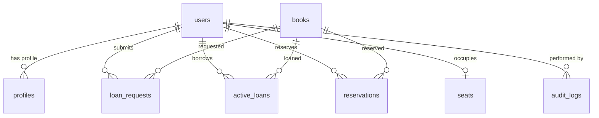

# 📚 SmartLIB-JAIN

<p align="center">
  
</p>

<p align="center">
  <strong>Next-Generation Digital Library & Real-Time Seat Allocation Management System</strong>
</p>

<p align="center">
  <a href="#-key-features">Key Features</a> •
  <a href="#-system-architecture">Architecture</a> •
  <a href="#-tech-stack">Tech Stack</a> •
  <a href="#-getting-started">Getting Started</a> •
  <a href="#-database-schema">Database Schema</a> •
  <a href="#-license">License</a>
</p>

<p align="center">
  
  
  
  
  
</p>

---

## 🌟 Overview

**SmartLIB-JAIN** is an enterprise-grade library management application tailored for modern higher education institutions (specifically optimized for **JAIN (Deemed-to-be University)**). It provides real-time circulation tracking, interactive floor-plan seat reservation, academic resource curation (VTU past papers and study materials), automated overdue fine computation, and administrative controls with comprehensive audit logging.

---

## ✨ Key Features

### 🪑 Real-Time Interactive Seat Allocation
- **Visual Floor Map**: Live visual representation of library zones (General, Quiet, Computer Lab).
- **Automated Check-in Window**: 15-minute grace period with automated seat release on no-shows.
- **Seat Booking Controls**: Configurable duration limits (1–3 hours) preventing seat hoarding.
- **Quick USN & Student Search**: Instant search for occupied seats by USN, Name, or Email.

### 📖 Circulation & Inventory Management
- **Catalog & Book Bank**: Support for regular circulation (14-day cycle) and semester-long Book Bank loans (180 days).
- **Concurrency-Safe Stock Updates**: PostgreSQL functions ensuring zero stock-race conditions (`increment_available_copies`, `decrement_available_copies`).
- **One-Click Requests & Approvals**: Seamless workflow from student request to librarian dispatch.
- **Automated Fines**: Real-time overdue fine engine with daily rates, waiving capabilities, and audit trails.

### 🎓 Academic & VTU Resources Hub
- Centralized repository for previous question papers, lecture notes, syllabus schemes (2022, 2018, etc.), and semester branches (CSE, AIML, ECE, ME, CE, MBA).
- Multi-cloud storage integration for direct file preview and external learning portals.

### 🛡️ Enterprise Security & Role-Based Access Control (RBAC)
- **Granular Postgres RLS**: Strict Row Level Security policies ensuring students can only access their records while authorized administrators oversee operations.
- **Audit Logging**: Every administrative action (fines waived, settings updated, loans processed) is immutably logged with timestamp and admin ID.

### 🌐 Multilingual & Adaptive UI
- Native support for **English**, **Hindi (हिंदी)**, and regional languages.
- Full **Dark Mode / Light Mode** support with smooth micro-interactions via Framer Motion.
- Progressive Web App (PWA) ready with mobile-responsive layouts.

---

## 🛠️ Tech Stack

| Layer | Technology |
|---|---|
| **Frontend Framework** | [React 19](https://react.dev/) + [TypeScript](https://www.typescriptlang.org/) |
| **Build Tool** | [Vite 7](https://vitejs.dev/) |
| **Styling** | [Tailwind CSS](https://tailwindcss.com/) + Custom Glassmorphism System |
| **Animations & Icons** | [Framer Motion](https://www.framer.com/motion/) + [Lucide React](https://lucide.dev/) |
| **Database & Auth** | [Supabase](https://supabase.com/) (PostgreSQL 17 with Row Level Security) |
| **Automations & Emails** | [EmailJS](https://www.emailjs.com/) + Heartbeat Trigger Engine |
| **Utilities** | Date-fns, QR Code React, Vite PWA |

---

## 📁 Project Structure

```bash
SmartLIB-JAIN/
├── public/                 # Static assets (logos, manifests, favicons)
├── src/
│   ├── assets/             # Vector icons and images
│   ├── components/         # Reusable UI components
│   │   ├── BookCard.tsx    # Book display card
│   │   ├── BookCover.tsx   # Dynamic book cover with fallback
│   │   ├── Layout.tsx      # Sidebar, top navigation & responsive shell
│   │   ├── SeatMap.tsx     # Interactive library floor seat map
│   │   └── ...
│   ├── context/            # React context providers
│   │   ├── AuthContext.tsx # User session, profile & role state
│   │   └── LanguageContext.tsx # Multilingual translations (EN, HI, etc.)
│   ├── lib/                # Core business logic & integrations
│   │   ├── EmailAutomator.ts # Due date & fine alert runner
│   │   ├── FineManager.ts  # Dynamic overdue calculation
│   │   ├── SeatManager.ts  # Auto-release expired seat bookings
│   │   └── supabase.ts     # Supabase client instantiation
│   ├── pages/              # Application views
│   │   ├── AdminDashboard.tsx
│   │   ├── AdminInventory.tsx
│   │   ├── AdminLoans.tsx
│   │   ├── AdminSettings.tsx
│   │   ├── Catalog.tsx
│   │   ├── Dashboard.tsx
│   │   ├── SeatsPage.tsx
│   │   └── ...
│   ├── App.tsx             # Route definitions & guards
│   └── main.tsx            # Entry point
├── supabase/
│   └── migrations/         # PostgreSQL schema, triggers & RPC functions
├── .env.example            # Environment template
├── tailwind.config.js      # Custom theme & color palette
├── tsconfig.json           # TypeScript configuration
└── vite.config.ts          # Vite build & PWA configuration
```

---

## 🚀 Getting Started

### Prerequisites
- **Node.js**: `v18.0.0` or higher
- **npm** or **pnpm** / **yarn**
- A **Supabase** project instance

### 1. Clone the Repository
```bash
git clone https://github.com/ManthanTP/SmartLIB-JAIN.git
cd SmartLIB-JAIN
```

### 2. Install Dependencies
```bash
npm install
```

### 3. Setup Environment Variables
Create a `.env` file in the root directory (based on `.env.example`):
```env
VITE_SUPABASE_URL=https://your-project-id.supabase.co
VITE_SUPABASE_ANON_KEY=your-supabase-anon-key
VITE_SUPABASE_PUBLISHABLE_KEY=your-supabase-publishable-key
```

### 4. Database Setup
Run the SQL migrations located in `supabase/migrations/` on your Supabase SQL editor:
1. `supabase/migrations/20240124_book_counters.sql` (Concurrency functions)
2. `supabase/migrations/20261117_new_supabase_trigger.sql` (Auth sync trigger)

### 5. Run Development Server
```bash
npm run dev
```
Navigate to `http://localhost:5173` in your browser.

---

## 🗄️ Database Architecture

The system utilizes 11 relational tables secured with PostgreSQL Row Level Security:



| Table | Purpose |
|---|---|
| `users` | Core user identity, role (`student` / `admin`), and status (`active`, `pending`, `suspended`) |
| `profiles` | Extended student attributes (USN / Student ID, Department, Academic Year) |
| `books` | Book catalog, ISBN, category, available and total copy counts, Book Bank flag |
| `loan_requests` | Circulations requested by students awaiting admin approval |
| `active_loans` | Issued books with due dates, accrued fines, and reminder history |
| `reservations` | Pre-booked titles held for scheduled pickup |
| `seats` | Seat identifiers, zones, check-in statuses, and live occupancy records |
| `acquisition_requests`| Student book requests with justification for librarian review |
| `system_settings` | Dynamic library parameters (daily fine rates, duration rules, departments) |
| `audit_logs` | Immutable log of admin modifications for full compliance |
| `academic_resources` | VTU question papers, curriculum schemes, and lecture study material |

---

## 📜 Available Scripts

- `npm run dev`: Starts the Vite development server with hot-reload.
- `npm run build`: Compiles TypeScript and builds optimized production bundles.
- `npm run preview`: Locally previews the production build.
- `npm run lint`: Runs ESLint for code quality checks.

---

## 🤝 Contributing

Contributions, issues, and feature requests are welcome!
1. Fork the Project
2. Create your Feature Branch (`git checkout -b feature/AmazingFeature`)
3. Commit your Changes (`git commit -m 'feat: add some amazing feature'`)
4. Push to the Branch (`git push origin feature/AmazingFeature`)
5. Open a Pull Request

---

## 📄 License

Distributed under the MIT License. See `LICENSE` for more information.

---

<p align="center">
  Crafted with ❤️ for <strong>JAIN (Deemed-to-be University)</strong>
</p>
